<a href="https://darusishak.com"></a>

### I ran plants. Now I build the systems behind them.

Chemical engineer from Shah Alam, Malaysia. Eight years inside mills, labs and biogas plants, from Kuala Lumpur to Turin to East Kalimantan. Since 2022 I write the software those plants run on: SCADA pipelines, fleet dashboards and reports the people on shift actually read.

In the evenings I run [Ruji Labs](https://rujilabs.com), where I ship products of my own. Most of the code is in private repositories, so this page is the map.

 

<picture>
  <source media="(prefers-color-scheme: dark)" srcset="assets/h-01-dark.svg">
  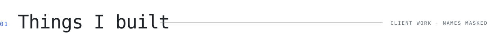
</picture>

<a href="https://darusishak.com/work/biogas/">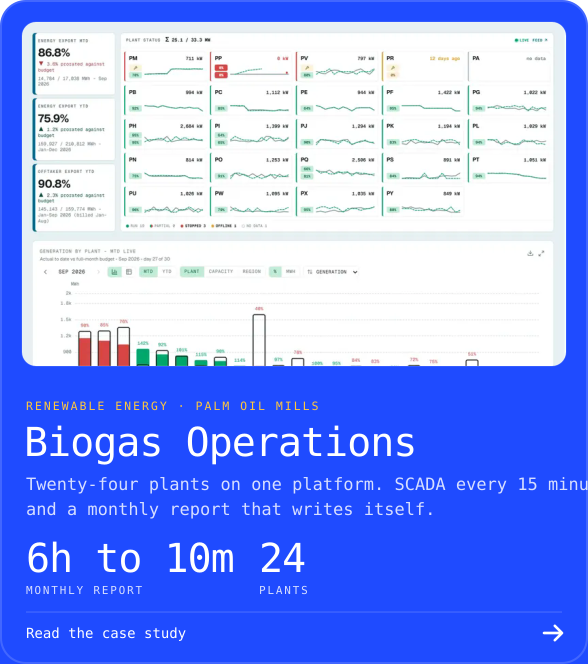</a>
<a href="https://darusishak.com/work/solar/">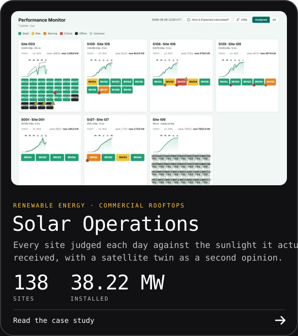</a>

 

<picture>
  <source media="(prefers-color-scheme: dark)" srcset="assets/h-02-dark.svg">
  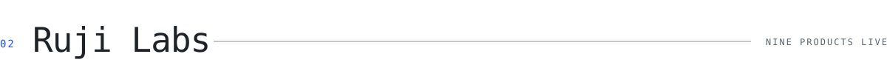
</picture>

<a href="https://rujilabs.com">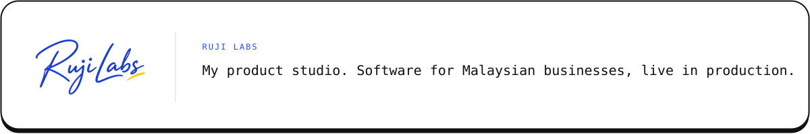</a>

<a href="https://post-lah.my">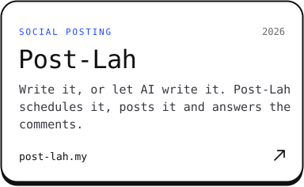</a>
<a href="https://nodex.my">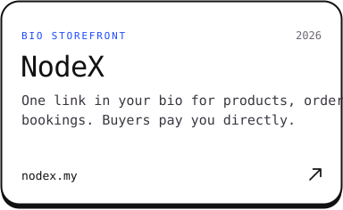</a>
<a href="https://berkira.com">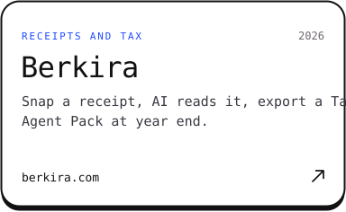</a>
<a href="https://conecta.my">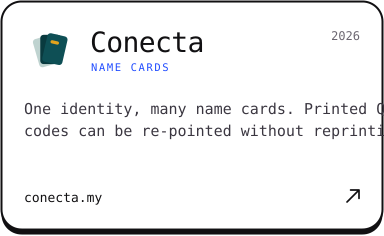</a>
<a href="https://workit.my">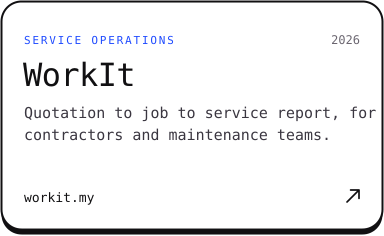</a>
<a href="https://semakcv.com">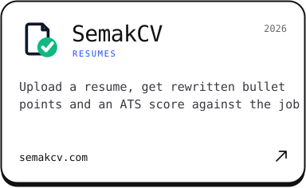</a>
<a href="https://rsvp-lah.my">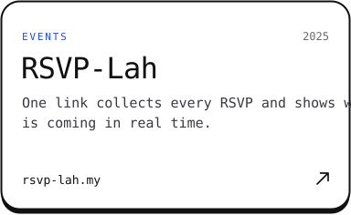</a>
<a href="https://app.e-tempah.com">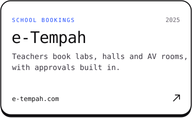</a>
<a href="https://powerbi.rujilabs.com">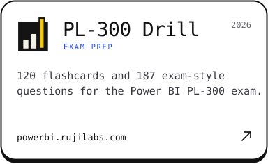</a>

 

<picture>
  <source media="(prefers-color-scheme: dark)" srcset="assets/h-03-dark.svg">
  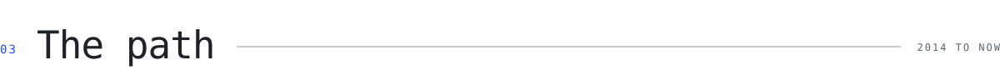
</picture>


 

<picture>
  <source media="(prefers-color-scheme: dark)" srcset="assets/h-04-dark.svg">
  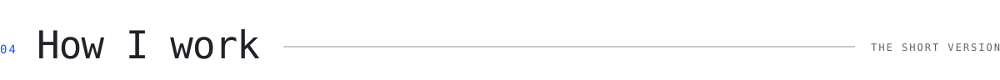
</picture>

- **I start on the floor.** Eight years on plant floors taught me who reads the screen. I build for the person on shift first and the report second.
- **One person, the whole stack.** Schema, API, UI, payments, deploys and the monitoring that tells me when something breaks.
- **Shipped beats perfect.** Every product above went live, then got better with real users on it.

`TypeScript` `Next.js` `React` `Node.js` `Python` `Django` `MySQL` `Prisma` `Cloudflare` `SCADA data` `Power BI` `BM + English`

 

**Say hello.** A plant, a process or a spreadsheet that runs your week: tell me about it.

[darusishak.com](https://darusishak.com) &nbsp;·&nbsp; [LinkedIn](https://www.linkedin.com/in/darusishak/) &nbsp;·&nbsp; [rujilabs.com](https://rujilabs.com) &nbsp;·&nbsp; [CV (PDF)](https://darusishak.com/cv/darus-ishak-cv.pdf)

<!-- you read the source. hello. the images are built by src/build.py -->
